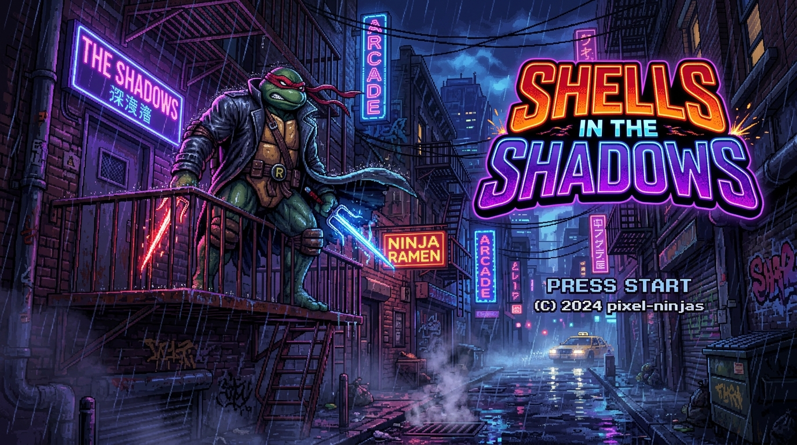
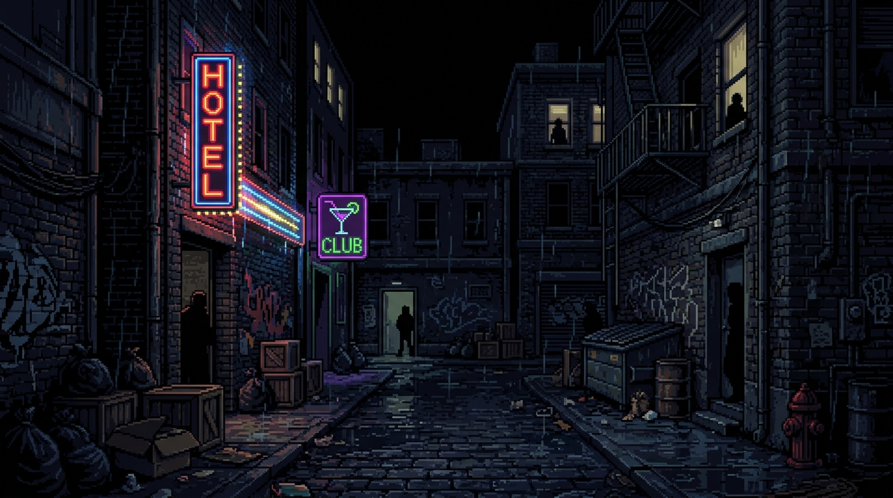
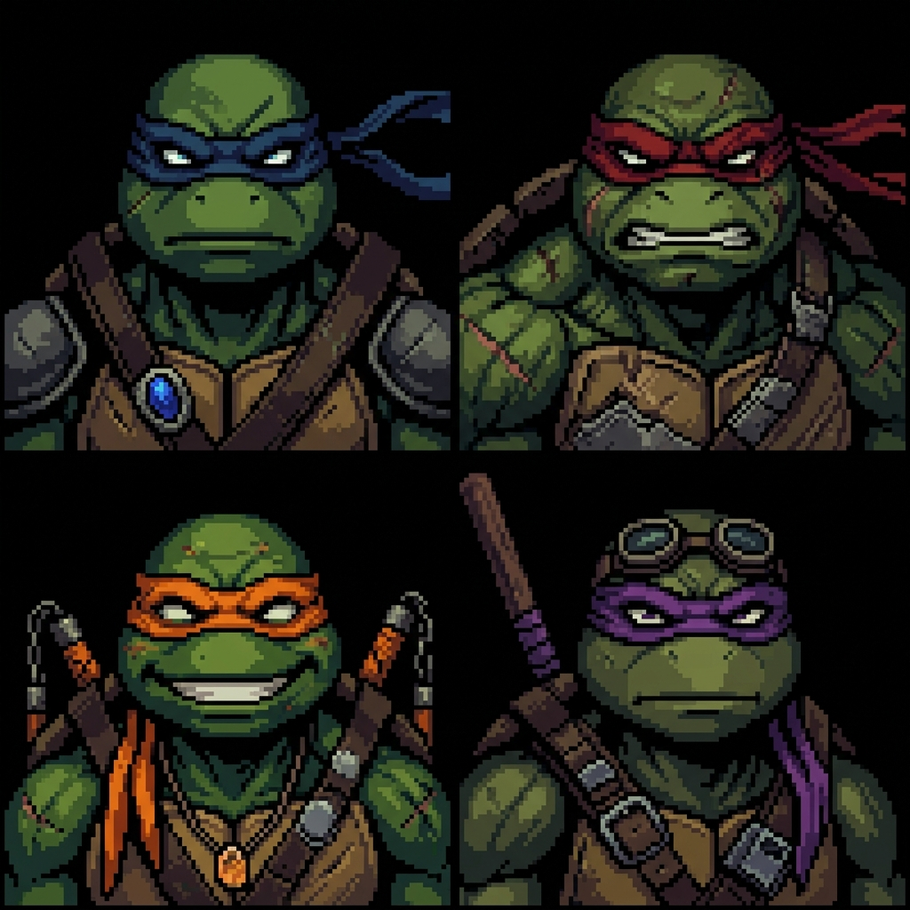

<div align="center">

# 🐢 Shells in the Shadows: Back Alley Tales

**A gritty 16-bit side-scrolling beat-em-up set in a rain-soaked urban underground.**

*Four brothers. Five screens of alley. One clan to purge.*




</div>

---

## 📖 Overview

**Shells in the Shadows: Back Alley Tales** is a browser beat-em-up inspired by classic 16-bit arcade brawlers. You pick a Turtle, purge the back alley of street thugs, Foot Soldiers, and cyber drones across escalating waves, and reach an AI-generated cutscene at the end of the district — all wrapped in a CRT-styled React shell with a live arcade HUD.

The game is built on **Phaser 4** for the canvas gameplay, **React 19 + Tailwind CSS 4** for the HUD/CRT presentation, an **Express 5** server, and the **Gemini API** for procedurally generated NPC dialogue.

### ✨ Features

- 🕹️ **Classic 2.5D beat-em-up combat** — move freely between depth lanes, punch combos, dodge rolls, jumps, and a screen-clearing special attack
- 🐢 **Four playable brothers** — Leonardo, Raphael (fully animated HQ sprites), Michelangelo, and Donatello, each with distinct speed/power/range stats
- 👾 **Three enemy archetypes** — bulky street thugs, agile Foot Soldiers that throw shurikens, and hovering cyber drones that fire plasma lasers
- 🌧️ **Atmospheric presentation** — dense procedural rain, parallax cityscapes, hit-stop, screen shake, blood/spark/debris particles, combo popups, and CRT scanline overlays
- 🔊 **Fully synthesized audio** — every sound effect *and the chiptune soundtrack* are generated with the Web Audio API at runtime. Zero audio assets required
- 🍕 **Pizza pickups** — slain enemies drop healing pizza (because it's the TMNT)
- 🤖 **AI-generated cutscenes** — the ending dialogue is written on the fly by Gemini and streamed into the HUD's "radio feed"
- 📱 **Touch controls** — virtual D-pad, attack/special/jump/roll buttons appear on any touch device (phones and tablets, portrait *or* landscape), with an on-screen pause button and tap-to-resume / tap-to-retry overlays
- 🏆 **Arcade systems** — lives, score, persistent high score (localStorage), special gauge, pause, and game-over/retry flow
- 🎛️ **Live React HUD** — health, lives, score, gauge, sector, and combo are synced from the game loop in real time

## 🎮 How to Play

### Controls

| Action | Keyboard | Touch |
| --- | --- | --- |
| Move (8-way, incl. depth lanes) | Arrow keys / WASD | D-pad |
| Attack (2-hit combo) | `Space` or `J` | **B** button |
| Special (requires 100% gauge) | `Z` or `K` | **A** button |
| Dodge roll (i-frames) | `Shift` or `L` | **ROLL** button |
| Jump (hop lanes / clear melee) | `X` or `I` | **JMP** button |
| Pause | `Esc` or `P` | ❚❚ button (top-right) |
| Advance dialogue / start | `Enter` / `Space` / tap | tap |

### Playing on a phone

The deployable build is fully touch-capable — no keyboard required:

- The **virtual gamepad appears automatically on any touch device** (detected via `pointer: coarse`, not viewport width, so large phones and tablets keep their controls in landscape too). It only shows during battle — never over menus.
- **Everything is tappable at runtime:** tap a turtle twice to deploy it, tap the ❚❚ button to pause, tap the *PAUSED* overlay to resume, and tap *GAME OVER* to retry.
- **The on-screen keyboard never pops up** — the game is canvas-driven with no focusable inputs, and double-tap zoom / pinch / pull-to-refresh / long-press menus are suppressed during play. A paired hardware keyboard still works: `Enter`/`Space` advance and retry exactly as on desktop.
- **Phone layout:** the HUD collapses to a compact header + mission strip so the alley fills the screen, controls respect notch/home-indicator safe areas, and a dismissible hint suggests rotating to landscape for the full 16:9 view.

### Characters

| Turtle | Weapon | Speed | Power | Range |
| --- | --- | :-: | :-: | :-: |
| Leonardo | Katana | 3 | 3 | 4 |
| Raphael | Sai | 2 | 5 | 2 |
| Michelangelo | Nunchaku | 5 | 2 | 3 |
| Donatello | Bo Staff | 2 | 3 | 5 |

### Enemies

- **Street Thug** — slow, bulky, heavy melee swings (30 HP)
- **Foot Soldier** — agile ninja that rushes in and throws spinning shurikens at mid-range (20 HP)
- **Cyber Drone** — hovering bot with jet-flare exhaust that fires plasma bolts (15 HP)

### Rules of the alley

- Clear every wave to advance a sector; each sector spawns more, tougher enemies
- You have **3 lives** — losing all health costs a life and respawns you deeper in the alley
- Kills build your **special gauge** (5% per hit); at 100% unleash the screen-clearing special
- Reaching the end of the district (5 screens) triggers the **AI cutscene**
- Score and high score persist locally

## 🚀 Getting Started

### Prerequisites

- **Node.js 20+** and npm
- (Optional) A [Google AI Studio](https://aistudio.google.com/) API key for AI cutscene dialogue — the game runs fine without one and falls back to scripted lines

### Install & run locally

```bash
git clone https://github.com/StavoMidnite661/TMNT.git
cd TMNT
npm install
cp .env.example .env.local   # add GEMINI_API_KEY if you want AI dialogue
npm run dev                  # http://localhost:3000
```

### Production build

```bash
npm run build     # bundles client to dist/ + compiles server to dist/server.cjs
npm start         # serves the production build on port 3000
npm run preview   # build + start in one step
```

### Scripts

| Command | Description |
| --- | --- |
| `npm run dev` | Dev server with Vite middleware + HMR |
| `npm run build` | Type-free production bundle (Vite + esbuild) |
| `npm start` | Serve the production build |
| `npm run lint` / `npm run typecheck` | TypeScript check (`tsc --noEmit`) |
| `npm run clean` | Remove build artifacts |

### Environment variables

| Variable | Required | Default | Description |
| --- | :-: | --- | --- |
| `GEMINI_API_KEY` | No | — | Google Gemini API key for AI-generated cutscene dialogue |
| `GEMINI_MODEL` | No | `gemini-3-flash-preview` | Gemini model used for dialogue generation |
| `PORT` | No | `3000` | Server port |
| `APP_URL` | No | — | Public URL where the app is hosted |
| `NODE_ENV` | No | — | Set to `production` to serve the built bundle |

## 🚀 Deployment

The game is a static SPA plus one optional AI endpoint — deployable anywhere.

**Note:** the game is fully playable without `GEMINI_API_KEY` (scripted fallback dialogue), so static hosts work out of the box.

### Vercel (recommended — full features)

[](https://vercel.com/new/clone)

The repo ships a [`vercel.json`](vercel.json). Push to GitHub, import the repo in Vercel, then add `GEMINI_API_KEY` under **Project → Settings → Environment Variables**. Vercel serves the built client from `dist/` and runs `/api/cutscene` as a serverless function (see [`api/cutscene.ts`](api/cutscene.ts)).

### GitHub Pages (static, fallback dialogue)

```bash
npm install
npm run deploy:pages   # builds and publishes dist/ to the gh-pages branch
```

Then enable GitHub Pages from the `gh-pages` branch in repo **Settings → Pages**. The build uses a relative base (`./`), so it also works on project sub-paths like `user.github.io/TMNT/`.

### Netlify / Cloudflare Pages / any static host

```bash
npm run build
# upload the contents of dist/
```

Optional: add a rewrite/proxy so `/api/cutscene` points at your own Express instance for AI dialogue.

### Self-hosted (full server)

```bash
npm run build
GEMINI_API_KEY=sk-... npm start   # serves dist/ + API on http://localhost:3000
```

## 🏗️ Architecture

```
TMNT/
├── server.ts                  # Express server: static hosting + /api endpoints
├── index.html                 # App shell (fonts, meta, favicon)
├── metadata.json              # AI Studio app metadata
├── src/
│   ├── main.tsx               # React entry
│   ├── App.tsx                # CRT shell + live arcade HUD
│   ├── index.css              # Tailwind + CRT scanline/bezel effects
│   └── game/
│       ├── config.ts          # Phaser game config
│       ├── constants.ts       # Canvas size, scene keys, turtle roster
│       ├── types.ts           # Shared TypeScript types
│       ├── hudBus.ts          # Phaser → React state bridge (pub/sub)
│       ├── PhaserGame.tsx     # React wrapper + virtual touch controls
│       ├── components/
│       │   ├── Player.ts      # Movement, combos, jump, dodge, specials, i-frames
│       │   └── Enemy.ts       # Thug / Foot Soldier / Drone AI & projectiles
│       ├── scenes/
│       │   ├── PreloadScene.ts        # Asset loading + procedural textures
│       │   ├── TitleScene.ts          # Animated title screen
│       │   ├── CharacterSelectScene.ts# Roster picker with stat bars
│       │   ├── MainScene.ts           # Core gameplay loop & combat
│       │   └── CutsceneScene.ts       # AI dialogue scene
│       └── utils/
│           └── SoundSynth.ts  # Web Audio API synthesized SFX
└── public/favicon.svg
```

**Key design decisions**

- **`hudBus`** — a tiny typed pub/sub lets Phaser push live state (health, score, gauge, combo, dialogue) into the React HUD without coupling the game engine to the DOM.
- **Procedural audio** — `SoundSynth` synthesizes every SFX with oscillators/filters, so the game ships with zero audio files.
- **Procedural rain** — the rain texture is generated on a canvas at boot; the game has no external runtime asset dependencies.
- **Edge flood-fill alpha keying** — the sprite art is JPEG-compressed (no alpha), so `PreloadScene` keys out the backdrop with a border flood-fill rather than a global color threshold, preserving interior whites/blacks in the sprites.

## 🔌 API

### `GET /api/health`

Liveness probe. Returns `{ "ok": true, "ai": <bool>, "model": "<id>" }`.

### `POST /api/cutscene`

Generates NPC dialogue for the ending cutscene.

```json
// Request
{ "sceneContext": "The turtle Raphael has cleared the back alley gangs...", "playerChoice": "Infiltrate" }

// Response
{ "dialogue": [ { "name": "Splinter", "text": "..." } ] }
```

- Input is validated (≤2000 char context, ≤200 char choice) and responses are sanitized (≤6 lines, ≤300 chars/line)
- Without `GEMINI_API_KEY` the endpoint returns `503` with scripted fallback dialogue — the game always remains playable

## 🖼️ Screenshots & Assets

| Title screen | Alley battlefield | Character portraits |
| --- | --- | --- |
|  |  |  |

All art is original, procedurally authored for this project and stored in `public/assets/images/` (used assets only — superseded iterations were pruned; see `CHANGELOG.md`).

## 🗺️ Roadmap

- [ ] Boss fights (Shredder, Krang) with multi-phase health bars and attack patterns
- [ ] Unique HQ spritesheets for Leo / Mikey / Donnie (currently tinted legacy fallback)
- [ ] 2-player local co-op ("INSERT COIN" HUD slot is already in place)
- [ ] More districts, enemy types, and vehicle chase levels (TMNT-style)
- [ ] Branching moral choices that persist across cutscenes (Gemini context memory)
- [ ] Weapon pickups (bo staff, nunchaku drops) and score-attack mode
- [ ] Gamepad API support

## 🤝 Contributing

Issues and PRs are welcome! For gameplay changes, please keep the 16-bit aesthetic in mind: pixel-art textures, monospace typography, and CRT effects are part of the identity. Run `npm run lint` before submitting.

## ⚖️ License & Disclaimer

MIT-licensed code (see [LICENSE](LICENSE)). This is an unofficial **fan project** for personal/educational purposes. Teenage Mutant Ninja Turtles and all related characters are trademarks of Paramount / Nickelodeon — this project is not affiliated with or endorsed by them.

---

<p align="center"><i>Cowabunga. Purge the alley.</i> 🐢</p>
